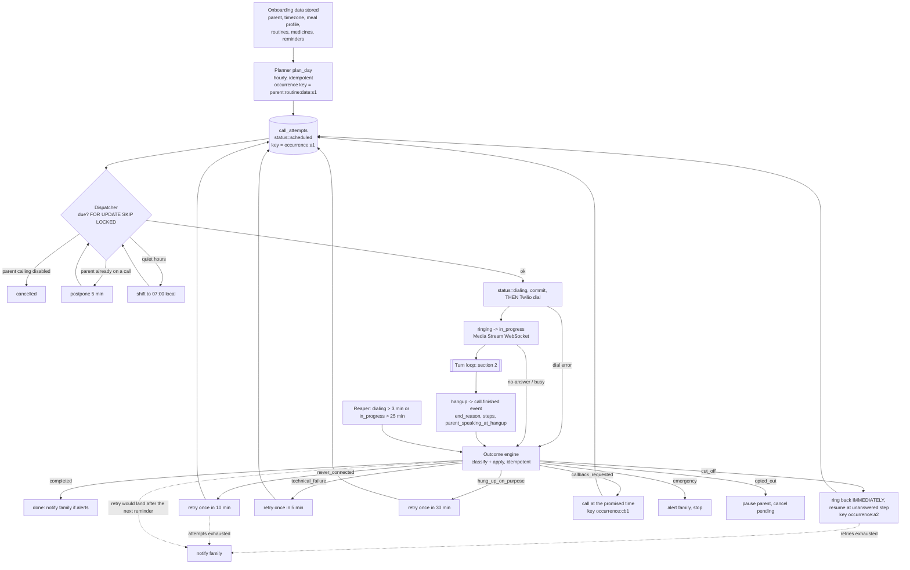
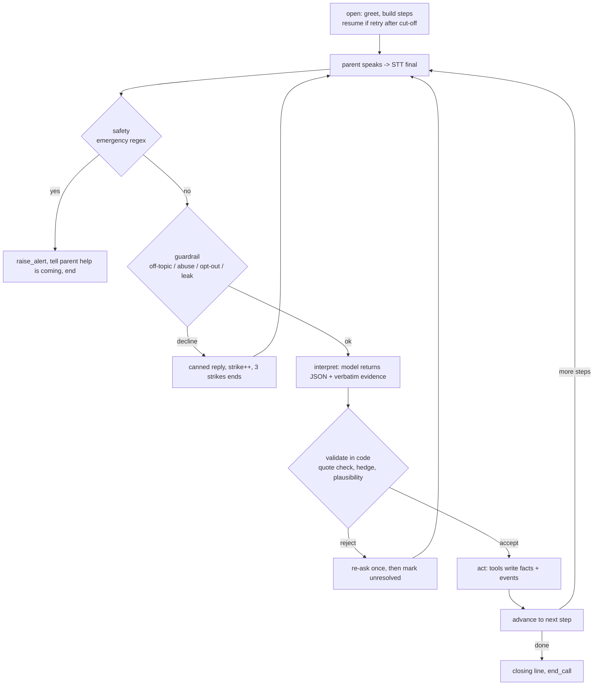

# CareCall call lifecycle

What happens after a parent is onboarded: stored data -> calendar -> dial -> conversation loop -> outcome -> next call.

## 1. The big loop (across calls)

## 2. The turn loop (inside one call)

## 3. Tools

| Tool | Writes | Idempotent by |
|---|---|---|
| log_meal | meal_logs | (call, meal_type) |
| log_medicine | medicine_logs | (call, medicine) |
| set_meal_time | meal_profile (source=stated/default) | upsert on (parent, meal) |
| ack_reminder | reminders | reminder id |
| schedule_callback | callbacks -> call_attempts `:cb<n>` | computed key |
| raise_alert | alerts + notify | (call, kind) |
| relay_message | messages | (call, message hash) |
| record_event | events (append-only) | none, append only |
| outcome.apply (engine, not the model) | outcome, follow-up attempt | `call.outcome` already set |

Tool design rules: plain functions taking validated args; the model never calls the database, it only fills an Interpretation; code validates; every tool appends an event; every write has a natural or computed key so a retry or duplicate webhook does nothing.

## 4. Keys

- occurrence key: `<parent>:<routine>:<local date>:s1`  (one per planned call)
- attempt key: `<occurrence>:a<n>` for retries, `<occurrence>:cb<n>` for callbacks
- UNIQUE on `idempotency_key`, so planner reruns, double dispatch and duplicate webhooks cannot create a second row.
- The active-call guard (`has_live_call`) is separate: it stops two different keys ringing the same parent at once.

## 5. Limits (settings in config.py)

- **2 attempts per reminder** (`max_attempts_per_occurrence`): the first call plus one more, then we stop and tell the family.
- A retry that would be due **after the next reminder** is dropped ("moving on to the next reminder"); dinner is never delayed by lunch.
- Parent already on a call: the dispatcher postpones **5 min** (`postpone_live_call_s`).
- Cut-off mid-sentence: ring back **immediately** (`cutoff_retry_delay_s=0`), resuming at the unanswered question.
- "Stop calling me" (in any ended call): calling is switched off, pending calls cancelled, and the **family is messaged**.
- When an occurrence ends (done or given up) the engine schedules **tomorrow's** call for the same routine.

## 6. Observability

Langfuse user = `parent-<id>-<name>` (one per parent); eval runs use `eval:<scenario>`. Session = `call-<id>`.
Admin API: `GET /admin/parents`, `/admin/calls?parent_id=`, `/admin/calls/{id}` (events, transcript, outcome, notifications).

## 7. Live scheduling (inside the call)

- The interpreter prompt now lists the request tool (`add_reminder`) with its exact argument schema, generated from the tool registry, plus `now_local` so "Friday at 4" becomes a real date. It only PROPOSES; code checks the quote, dry-runs the tool, and the agent reads it back ("Shall I set that?"). Only a clear yes runs it.
- A call back is booked at once with `book_callback` (a real `call_attempts` row, key `<occurrence>:cb<n>`). What the agent says aloud ("in 10 minutes" / "at 7 in the morning tomorrow") comes from the tool's result, so it can never promise a time the system did not book. If the tool refuses (calls off, next reminder due first, too many call-backs), the agent says so and tells the family.
- While a tool runs the agent says a filler ("Umm... hold on a moment, let me note that down."). On a phone line the bridge plays it immediately (`speak_now`); in text it leads the reply. It is in the transcript either way.
- After hang-up, `outcome.apply` keeps whatever was booked live (`followup.already_scheduled`) and adds nothing; when that call-back itself finishes, tomorrow's call for the routine is scheduled.
- Test: `carecall live-scheduling` (LLM parents, real interpreter, real Postgres, judge). Last run: 35/35 checks, human-likeness 4.0/5.

## 8. Who controls what (product rule)

- **Meal times are fixed by the caretaker**, never by the parent. The calls follow the defaults (08:30 / 12:30 / 19:30) overridden only by times the caretaker set (`MealProfile.source = "caregiver"`), through `effective_meal_times()`.
- What a parent says about their meals is kept as a record (profile source `stated`, plus an event) and never moves the schedule. The agent cannot overwrite a caretaker-fixed time, and `update_meal_time` is admin-scope only (not offered to the live agent or the post-call agent).
- The caretaker sets times with `PUT /admin/parents/{id}/meal-times`; they apply from the next day planned.
- **What a parent can do on a call:** ask to be reminded again (a call-back booked live) or ask to be reminded about something else (`add_reminder`, read back and confirmed first).
